<!-- Generated from profile.config.ts by `bun run build`. Edit the config, not this file: changes here are overwritten. -->

  

  

## WHO AM I?

I'm a full stack developer with a passion for Cyber Security. I enjoy finding out how things work, delving into the unknown and how to keep them safe/secure.

<b>How I got here:</b> Java was my first language and gave me the foundations to pick up Python, C, C++, JavaScript, etc... Additionally, I can now confidently learn any programming language from learning the fundamentals of programming.

I have recently gone from a BSc (Hons) in Computer Science at Swansea University to an NCSC-certified MSc in Cyber Security (Distinction) at Cardiff University, where I worked on penetration testing, malware analysis, incident response and cyber risk management.

<b>What I do:</b> I build and secure production web platforms end to end, across WordPress, Laravel and Vue/Nuxt on AWS and Terraform, and bring security into every stage, from secure coding and hardened authentication to monitoring and incident response.

<b>What I'm working on:</b> the Google Cybersecurity Professional Certification, hands-on labs on TryHackMe and Hack The Box, and my own security tooling, including a local AWS security lab and a mini SIEM.

## My Tech Certifications

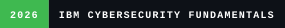

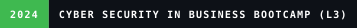

## Featured Projects

  <a href="https://github.com/sam-ash-cy/dual-check-2fa">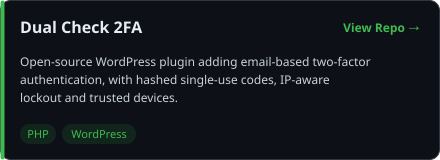</a>
  <a href="https://github.com/sam-ash-cy/VS-Sound">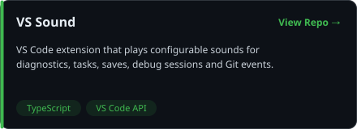</a>
  <a href="https://github.com/sam-ash-cy/Discord-Bot">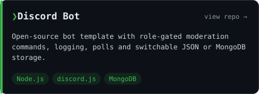</a>
  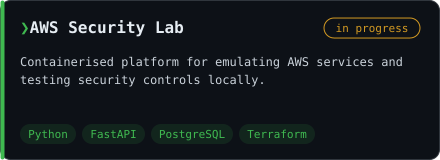
  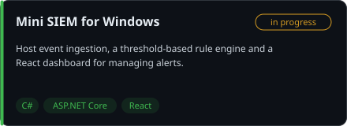

## Full Tech Stack

### Language Stack

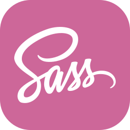

### Framework Stack

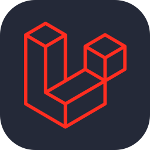

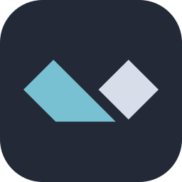

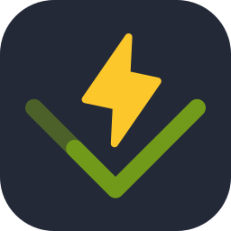

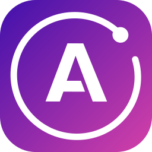
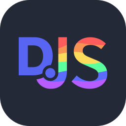

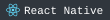
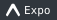
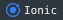
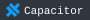
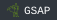
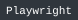

### Data Engineering Stack

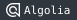
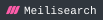
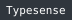

### Cloud/Devops Stack

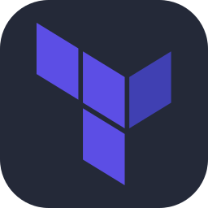

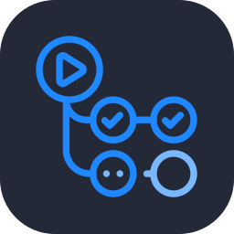

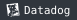
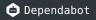
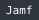

### Security Stack

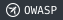
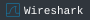
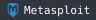
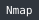
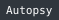
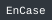
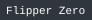
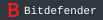

  

