<!-- Terminal theme: accent 3fb950 on 0d1117. The header and footer are animated SVGs kept in assets/ so no third-party service can break them. -->

  

  

## WHO AM I?

<samp>I'm a full stack web developer with a security-first approach. I build and maintain production web platforms across WordPress, Laravel and Vue/Nuxt, and look after the cloud infrastructure, CI/CD and security practices behind them.</samp>

<samp>I hold an NCSC-certified MSc in Cyber Security (Distinction) from Cardiff University and a BSc (Hons) in Computer Science from Swansea University. My interests sit where development meets security: secure coding, hardening authentication, cloud security and security operations.</samp>

## My Tech Certifications

<!-- Green label = year completed, amber label = in progress. -->

## Full Tech Stack

### Language Stack

### Framework Stack

     

### Data Engineering Stack

  

### Cloud/Devops Stack

  

### Security Stack

       

  

